# 指标复盘盒子（a-sm-box）

一个 A 股技术指标复盘小工具，单机运行，打开浏览器就能用。

它做的事情很简单：把自选股票的日 K 线拉到本地，按一套公开的规则计算技术指标，
把结果摆出来供复盘时查看；另外带一个按固定规则运行的虚拟盘和一本交易日记。
所有计算规则都写在代码里，可以直接读、直接改。

这是我们自用系统的精简版，拿出来和做交易的朋友交流，也可以当作一份学习样本。
没有账号系统，启动后谁都可以访问全部功能；不需要任何密钥，克隆下来直接就能跑。

## 功能

<p align="center">
  <a href="docs/images/watch.png">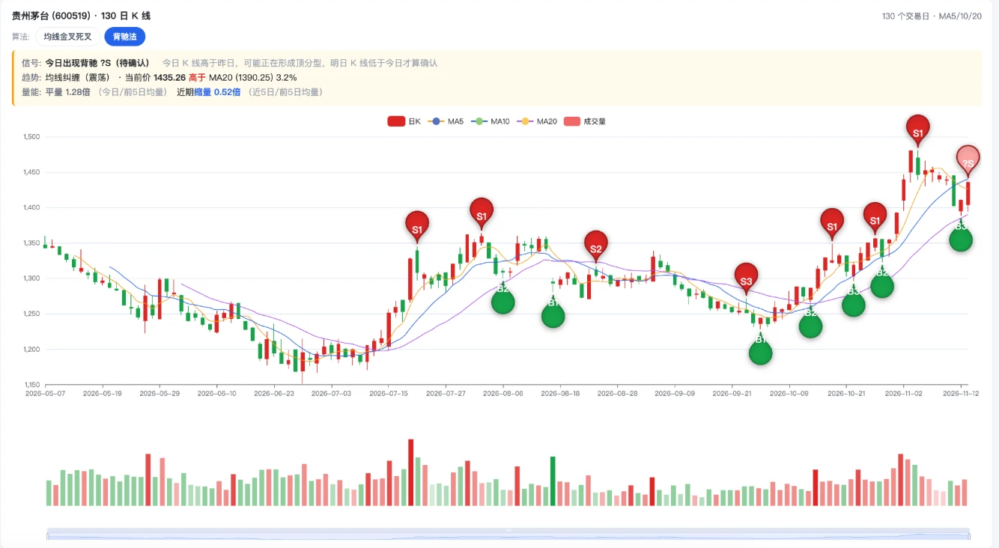</a>
</p>

点任意图片可以查看完整页面的原图。

### 大盘研判

从趋势、宽度、资金、量能、动量五个维度给大盘打分，合成一个 0~100 的温度，并列出四大指数和涨跌家数等关键数据。
页面顶部另有两张卡片：盘前哨兵（隔夜外盘的涨跌情况）和涨停情绪（涨停家数、连板高度、炸板率）。

<a href="docs/images/market.png">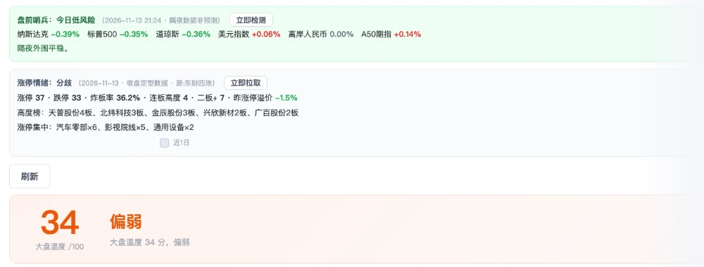</a>

### 自选分组

手动维护股票分组，默认自带一个「全部」分组。点任意一只股票，右侧显示 130 日 K 线（见最上面的图），
可在均线金叉死叉、背驰两种标注之间切换。每只股票可以单独打开分析弹窗，查看指标分、各项指标的计算结果和关键价位。

### 扫描结果

对一个分组里的全部股票批量计算指标（指标扫描），结果按指标分从高到低排列。
可以按 B 点（几天内出现）、均线金叉死叉（几天内出现）、连续买点个数、趋势四个条件筛选，也可以按名称或代码搜索。

<a href="docs/images/scan.png"></a>

<table>
  <tr>
    <th width="56%">扫描结果列表</th>
    <th width="44%">个股分析弹窗</th>
  </tr>
  <tr>
    <td valign="top"><a href="docs/images/scan.png">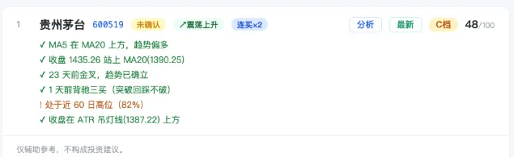</a></td>
    <td valign="top"><a href="docs/images/scan.png">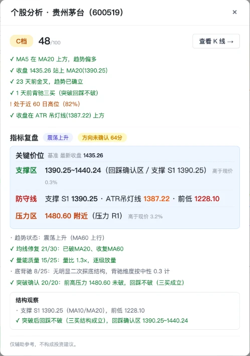</a></td>
  </tr>
</table>

### 模拟盘与复盘日记

**模拟盘**：A、B、C 三个策略各有 10 万虚拟资金，按各自固定的规则在每个交易日收盘后自动结算，
记录持仓、成交流水和已平仓明细，并画出各策略与沪深 300 的收益曲线对比。

**复盘日记**：记录自己的真实买卖。平仓时自动计算含手续费的盈亏和持有天数；可以给每笔交易打标签，按标签统计笔数、胜率和累计盈亏。

## 完整版一览

这个仓库是精简版，只保留了上面五个页面。我们自用的完整版在此基础上覆盖了更多场景，下面是其中几个页面。

### 全市场自选与 K 线

自选分组可以一键同步全市场股票。K 线面板除了日线，还能切到当日 5 分钟线，并显示市值、换手、所属行业和题材等信息。

<a href="docs/images/full-watch.png">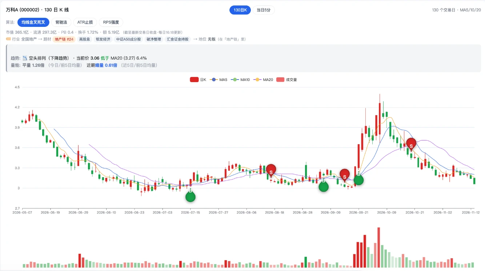</a>

### 题材热榜

把近期的涨停按题材归类，一眼看出哪些题材在持续活跃、活跃了多少天，以及题材里的代表个股。

<a href="docs/images/full-hot.png">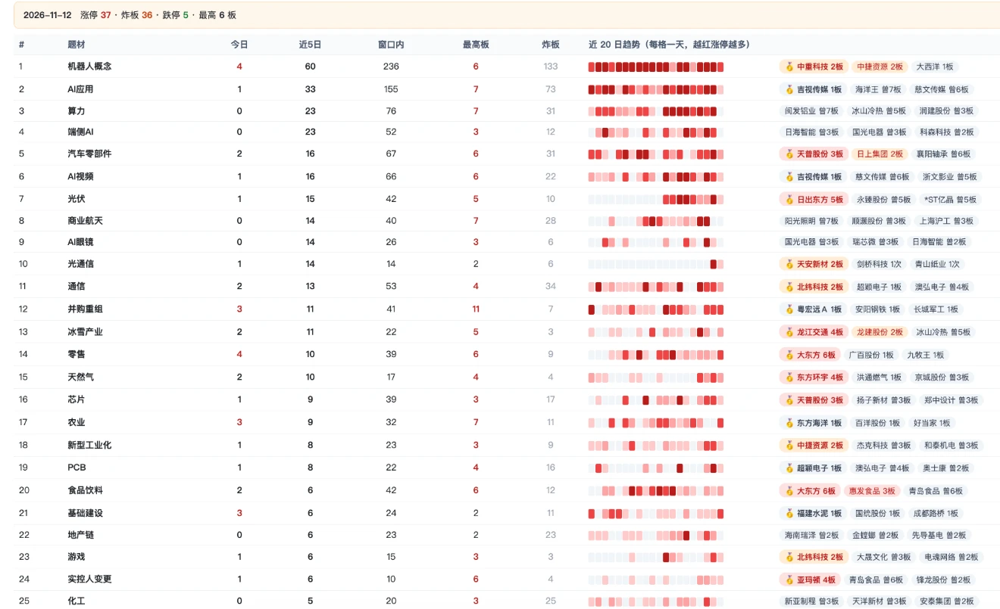</a>

### 涨停看盘

当日涨停、连板、炸板、跌停的全景：市场热度、封板率、连板晋级率、各板位家数，以及按连板高度排列的个股列表。

<a href="docs/images/full-board.png">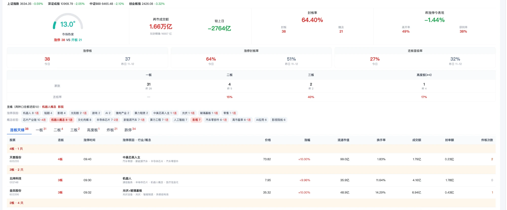</a>

### 手机端

手机上也能用：首页进各个功能，随时查看 K 线、题材热榜和扫描结果，还可以用一句话向助手提问。

<table>
  <tr>
    <th width="50%">首页</th>
    <th width="50%">个股 K 线</th>
  </tr>
  <tr>
    <td valign="top"><a href="docs/images/full-mobile-home.png">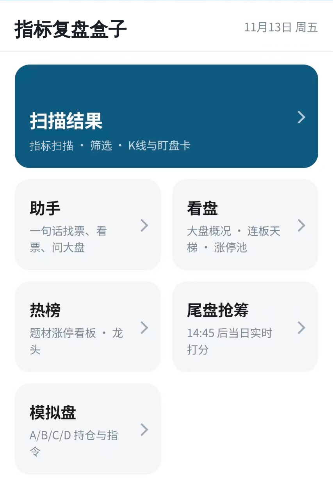</a></td>
    <td valign="top"><a href="docs/images/full-mobile-kline.png">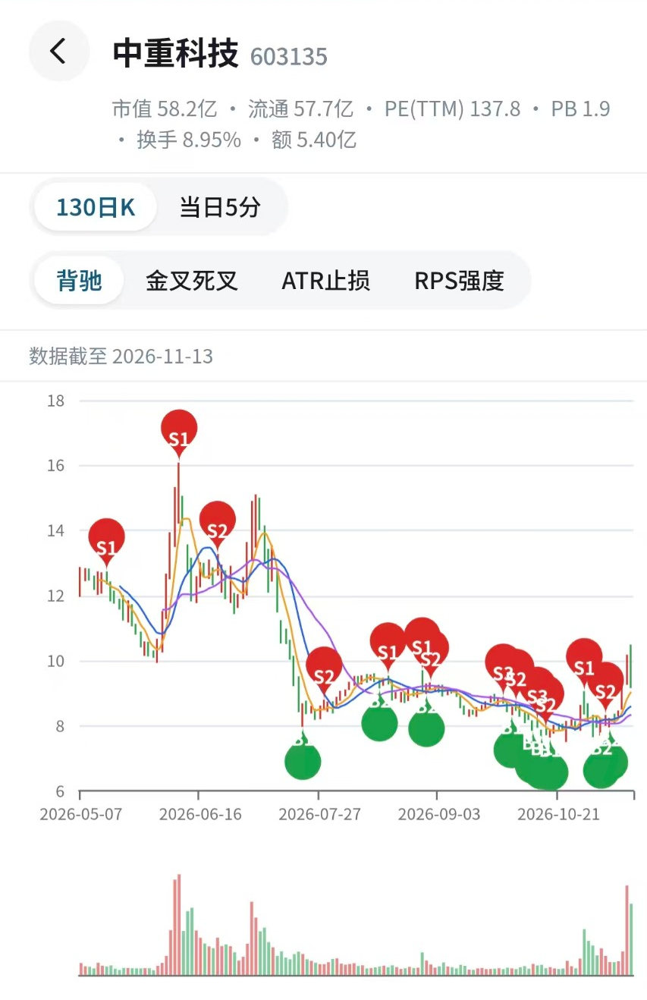</a></td>
  </tr>
  <tr>
    <th>题材热榜</th>
    <th>助手</th>
  </tr>
  <tr>
    <td valign="top"><a href="docs/images/full-mobile-hot.png">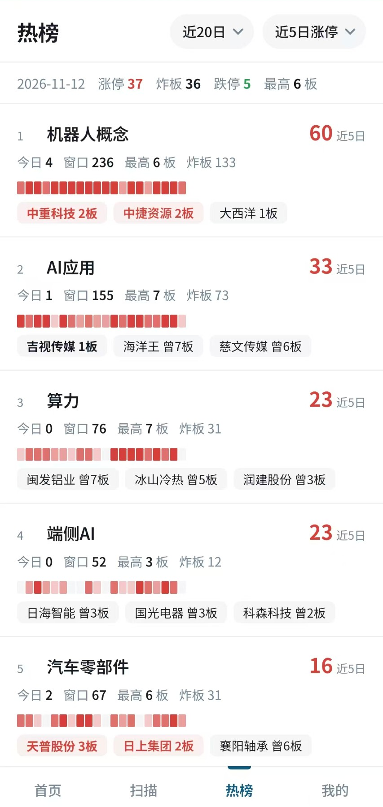</a></td>
    <td valign="top"><a href="docs/images/full-mobile-assistant.png">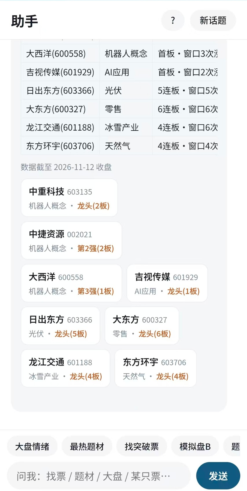</a></td>
  </tr>
</table>

### 还有这些

| 模块 | 说明 |
| --- | --- |
| 尾盘扫描 | 盘中用当日实时行情重新扫描一遍分组 |
| 盘后扫描 | 收盘后按固定条件筛出当日名单，可一键建成分组 |
| 主线题材 | 概念与行业板块的行情榜和近几日的热度变化 |
| 回测 | 用历史数据检验各项指标信号 |
| 更多筛选条件 | 扫描结果支持十几种条件组合 |
| 更多 K 线视图 | 在金叉死叉、背驰之外的其他标注方式 |
| 更多模拟盘策略 | 多个策略并行运行、同图对比 |
| 多账号 | 登录，并按账号分配可见的分组和功能 |
| 数据备份 | 数据库定时快照 |

## 运行

需要 JDK 8 及以上、Maven。

```bash
mvn spring-boot:run
```

启动后打开 http://localhost:8080 。

数据存在 `./data/` 下的 H2 文件库里，删掉这个目录就是重置。

### 第一次使用

1. 到「自选分组」，在默认的「全部」分组里录入股票名称或代码（也可以新建别的分组）。
2. 点右上角「刷新自选K线」，等日 K 缓存拉完（页面副标题会显示进度）。
3. 回到分组点「指标扫描」，结果会存进「扫描结果」页。
4. 「模拟盘」每个交易日 19:30 自动结算，也可以手动点「立即结算」。

## 配置

行情数据全部来自东方财富和腾讯的公开接口，不需要申请任何 token，项目里也没有任何密钥，克隆下来直接就能跑。

如果本地网络直连不了行情接口，可以用环境变量指定一个 HTTP 代理：

```bash
SMBOX_PROXY_HOST=127.0.0.1 SMBOX_PROXY_PORT=7890 mvn spring-boot:run
```

其他配置在 `src/main/resources/application.yml`，例如 `smbox.schedule-enabled: false` 可以关掉全部定时任务。

## 定时任务

周一到周五触发，没有识别交易所节假日（节假日运行只会拉到空数据，模拟盘会自动跳过）。

| 时间 | 任务 |
| --- | --- |
| 08:35 | 盘前哨兵 |
| 15:05 | 大盘研判归档 |
| 16:05 | 预热自选分组日 K |
| 16:15 | 涨停情绪存档 |
| 19:30 | 模拟盘结算 |

## 代码结构

```
src/main/java/com/smbox
├── datasource/   行情接口客户端：东方财富（主）、腾讯（备用）
├── service/      业务逻辑
│   ├── AnalysisEngine     打分、背驰买卖点、形态判别、突破形态（与前端 JS 同一套算法）
│   ├── MarketService      大盘研判
│   ├── WatchlistService   自选分组、日 K 预热
│   ├── SimService         模拟盘
│   ├── TradeJournalService 复盘日记
│   └── ...                RPS、涨停情绪、盘前哨兵、几个观察标签
├── storage/      JdbcTemplate 仓储，表结构见 resources/schema.sql
├── schedule/     定时任务
└── web/          REST 接口
src/main/resources/static/index.html   单页前端（原生 JS + ECharts）
```

跑测试：

```bash
mvn test
```

## 数据源说明

东方财富和腾讯的接口都是非官方接口，没有可用性保证，字段和限频策略可能随时调整。
拉不到数据时先看日志，必要时对照 `datasource/` 里的客户端修改。

## 赞助

这个项目免费开源，没有任何付费内容。如果它对你有帮助，欢迎请作者喝杯茶，金额随意，纯属自愿。


赞助不对应任何服务或回报，也不提供投资建议。

## 开源协议

[MIT](LICENSE)

## 免责声明

本项目仅用于技术交流和学习，不构成任何投资建议。
页面上的评分、判别、买卖点和模拟盘结果都是基于历史日线的启发式规则，不代表未来表现。
据此操作产生的任何盈亏由使用者自行承担。
